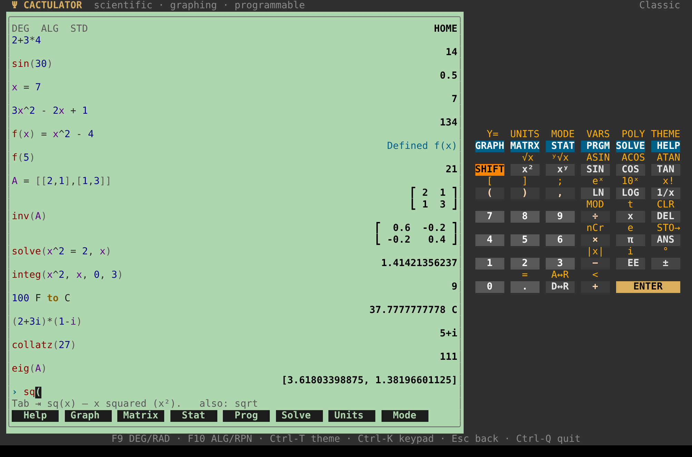
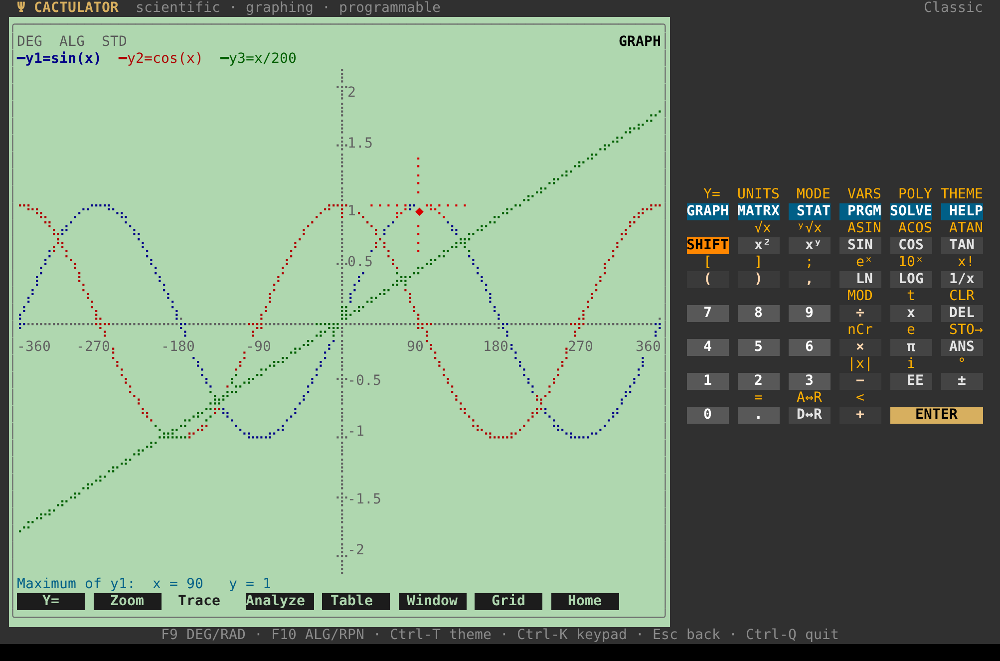
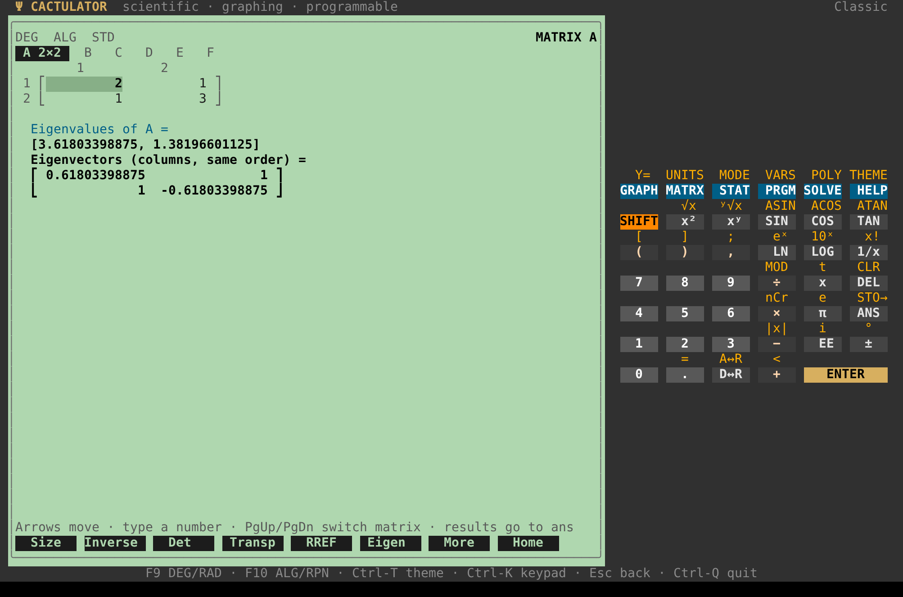
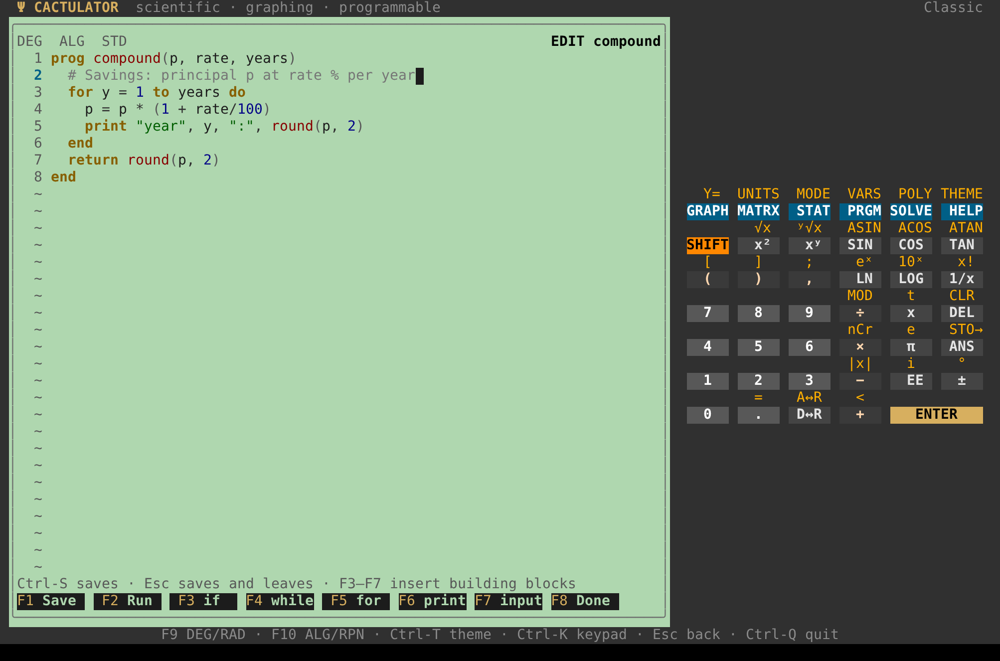
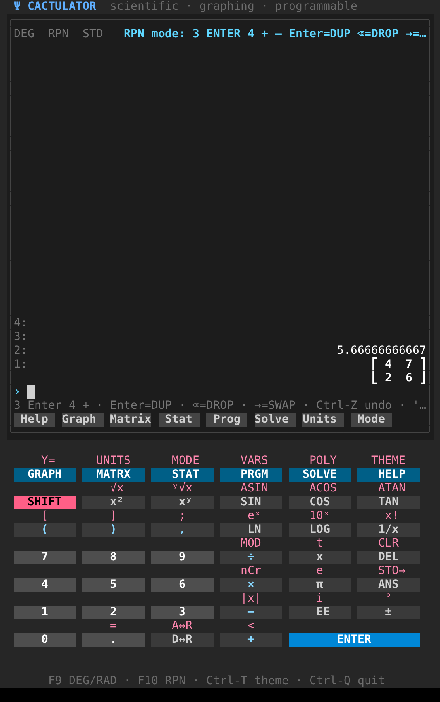

# Cactulator

A TUI and REPL calculator written mostly in C++ — a **programmable graphing
calculator for your terminal**, inspired by the classic HP calculators but made
to be as easy as possible to use.



* **Type math the way you write it** — `2+3*4`, `sin(30)`, `√2`, `3x^2 - 2x + 1`,
  `5!`, `(2+3i)*(1-i)` — or switch to a real **HP-style RPN stack** with one key (F10).
* **Graphs** drawn with high-resolution braille dots: up to 6 functions at once, parametric
  and polar curves, trace, zoom, pan, and one-key **root / minimum / maximum / intersection /
  slope / area** finding, plus a table of values.
* **Matrices**: a spreadsheet-like editor, inverse, determinant, transpose, RREF, rank,
  eigenvalues and eigenvectors, solving `A·x = b`.
* **Programming**: one-line functions (`f(x) = x^2 + 1`) and real programs with
  `if / while / for / repeat`, lists, `print` and `input`, in a built-in code editor.
* **Solver & calculus**: solve any equation for any variable (HP-style SOLVE app), polynomial
  roots (also complex), numerical derivatives, integrals (even to infinity), sums and products.
* **Statistics**: data lists, mean / median / SD / quartiles, linear, quadratic, cubic,
  exponential, power and logarithmic fits with R², scatter plots, and probability
  distributions (normal, binomial, Poisson, t, χ², F).
* **Everything else a scientific calculator does**: complex numbers, fractions, hex/binary/octal,
  unit conversion (`5 km to mi`, `100 F to C`), physical constants, random numbers, number theory.
* **Clickable on-screen keypad** with SHIFT functions, 5 color themes, a built-in guide and a
  searchable catalog of every function. Your variables, programs and history are saved
  automatically.

| Graphing | Matrices |
|---|---|
|  |  |
| **Program editor** | **RPN mode, Midnight theme, tall window** |
|  |  |

## Building

You need a C++17 compiler and ncurses (with wide-character support).

**Linux / WSL**

```bash
sudo apt install build-essential libncurses-dev    # Debian/Ubuntu (Fedora: gcc-c++ ncurses-devel)
```

```bash
make
```

```bash
./cactulator
```

**macOS** (ncurses ships with the system)

```bash
xcode-select --install
```

```bash
make && ./cactulator
```

**Windows** — install [MSYS2](https://www.msys2.org), open the *MSYS2 UCRT64* terminal, then:

```bash
pacman -S --needed mingw-w64-ucrt-x86_64-gcc mingw-w64-ucrt-x86_64-cmake mingw-w64-ucrt-x86_64-ncurses make
```

```bash
cmake -B build -G "MSYS Makefiles" && cmake --build build
```

```bash
./build/cactulator.exe
```

Run it inside **Windows Terminal** for the best colors and Unicode support.

**Android (Termux)**

```bash
pkg install clang make ncurses
```

```bash
make && ./cactulator
```

CMake works everywhere too: `cmake -B build && cmake --build build && ./build/cactulator`.
Run the tests with `make test` (or `ctest --test-dir build`).

## Your first five minutes

Never used a graphing calculator? Start here.

1. **Calculate.** Type `2+3*4` and press **Enter**. Press **↑** to get it back and edit it.
   Start a line with an operator to continue from the last answer (`*2`).
2. **Store things.** `x = 7`, then `3x + 1`. Make your own function: `f(x) = x^2 - 4`, then `f(5)`.
3. **Draw a graph.** Type `plot f(x), x` — or press **F2**. Press **F3** to trace along the curve,
   then **F4 → Root** to find where it crosses zero. **Esc** brings you back.
4. **Try a matrix.** Press **F3** on HOME, type the numbers into the grid, press **F2** for the inverse.
5. **Ask for help.** **F1** opens the guide; its *Catalog* tab lets you search every function
   (type `matrix`, `angle`, `prob`…) and press Enter to use it.

The bottom line always explains the function you're typing, and **Tab** completes names.

## Cheat sheet

| You want | Type |
|---|---|
| Powers, roots | `2^10`, `sqrt(2)` or `√2`, `cbrt(-8)`, `root(32, 5)` |
| Trig (DEG/RAD with **F9**) | `sin(30)`, `asin(0.5)`, `sin(30°)` in RAD mode |
| Logs | `ln(e)`, `log(1000)`, `log(8, 2)` |
| Fractions | `frac` then `1/3 + 1/6` → `1/2` |
| Complex | `sqrt(-4)`, `(3+4i)*(1-2i)`, `abs(3+4i)`, `arg(1+i)` |
| Solve | `solve(x^2 = 2, x)`, `solve(cos(x) = x, x, 1)` |
| Calculus | `deriv(x^3, x, 2)`, `integ(exp(-x^2), x, -inf, inf)`, `sum(1/k^2, k, 1, inf)` |
| Polynomials | `polyroots([1, -6, 11, -6])` → `[1, 2, 3]` |
| Matrices | `A = [[1,2],[3,4]]`, `inv(A)`, `det(A)`, `A'`, `A^3`, `eig(A)`, `solve(A, [5, 11])` |
| Lists & stats | `mean([2, 4, 9])`, `sd(L1)`, `linreg(L1, L2)`, `sort(v)`, `seq(k^2, k, 1, 10)` |
| Probability | `nCr(10, 3)`, `normcdf(-1.96, 1.96)`, `binompdf(10, 0.5, 5)`, `invnorm(0.975)` |
| Units | `5 km to mi`, `100 F to C`, `1 atm to kPa`, `convert(3, "cup", "mL")` |
| Bases | `hex(255)`, `0xFF + 0b101`, or the commands `hex` / `dec` |
| Constants | `pi`, `e`, `i`, `phi`, `_c`, `_h`, `_NA`, `_R`, `_kB`, `_g` … |

Commands you can type on HOME: `deg` `rad` · `fix 4` `sci 3` `eng 2` `std` · `frac` · `hex` `bin`
`oct` `dec` · `rpn` `alg` · `vars` · `del name` · `cls` · `plot f, g` · `polar r` · `param x, y` ·
`theme Midnight` · `keypad` · `help name` · `quit`.

## Keys

| Key | Does |
|---|---|
| Enter / Esc | calculate · clear the line or go back to HOME |
| ↑ ↓ | earlier entries on HOME, move around in apps |
| Tab | complete a name |
| F1 … F8 | the soft keys shown at the bottom of the display |
| F9 / F10 | degrees ⇄ radians / algebraic ⇄ RPN |
| Ctrl-T / Ctrl-K | next color theme / show-hide the keypad |
| Ctrl-Z | undo (RPN) |
| Ctrl-Q | quit (everything is saved) |

The mouse works too: click keypad keys and soft keys, click a result to reuse it, click a curve
to trace it, scroll to zoom graphs. (Hold Shift to select text in most terminals.)

**RPN**: `3 Enter 4 +` gives 7. With nothing typed, Enter duplicates, ⌫ drops and → swaps,
just like an HP 48. Words like `swap drop dup over rot clear sto x` work too, and `'x^2+1'`
evaluates algebra inside RPN.

## Programming

```text
prog collatz(n)
  # How many steps until the Collatz sequence reaches 1?
  steps = 0
  while n != 1 do
    if n % 2 == 0 then
      n = n / 2
    else
      n = 3*n + 1
    end
    steps = steps + 1
  end
  return steps
end
```

Run it from HOME with `collatz(27)` → `111`. The language has `if … then … elif … else … end`,
`while … do … end`, `for k = 1 to 10 step 2 do … end`, `for v in list do … end`,
`repeat … until cond`, `return`, `break`, `continue`, `print a, b`, `x = input("prompt")`,
`global x`, comments with `#`, lists (`v = []`, `v[3] = 5`) and matrices (`A[2, 1] = 7`).
Variables inside programs are local. Press **Esc** to stop a program that runs too long.
Examples (`collatz`, `quadratic`, `fib`, `primes`, `guess`, `compound`) are installed on the
first run — open them with **F5**.

## Command line

```text
cactulator                    full-screen calculator
cactulator -e "inv([[1,2],[3,4]])" -e "solve(x^2 = 2, x)"
echo "5 km to mi" | cactulator     plain REPL when input is piped (or --repl)
cactulator --ascii            no box-drawing/braille characters
cactulator --no-mouse         keep the terminal's normal mouse selection
cactulator --theme Paper      Classic, Cactus, Retro LCD, Midnight or Paper
cactulator --fresh            ignore the saved state
```

Your variables, programs, graphs, settings and history are stored in
`~/.config/cactulator/state.txt` (`%APPDATA%\Cactulator\state.txt` on Windows; set
`CACTULATOR_HOME` to use another folder). It's a plain text file.

## Project layout

```text
src/core/    math engine (no UI): parser, interpreter, builtins, linear algebra,
             numerics, statistics, units, RPN, session state
src/ui/      ncurses interface: terminal wrapper, themes, braille canvas, keypad,
             and one file per app (calc, graph, matrix, stat, prog, solve, units, help, mode)
src/repl.cpp line-based mode;  src/main.cpp  command-line entry point
tests/       core test suite (make test)
experiments/ the original escape-code experiments this project started from
```

Numbers are IEEE doubles (about 15–16 significant digits; results are shown with 12, like an HP).
Calculus and solving are numerical, not symbolic.

## License and no warranty

Copyright (C) 2026 StochasticCactus.

Cactulator is free software: you can redistribute it and/or modify it under the terms of the
GNU General Public License as published by the Free Software Foundation, either version 2 of
the License or (at your option) any later version. See [LICENSE](LICENSE) for the full text.

**Cactulator is provided "as is", WITHOUT ANY WARRANTY**, without even the implied warranty of
merchantability or fitness for a particular purpose, to the extent permitted by applicable law.
The authors are not liable for any damages arising from its use, including results that are
wrong or inaccurate. Like any calculator software, it can make mistakes (it uses floating-point
arithmetic and numerical methods), so **double-check anything important** — and don't rely on
it alone for safety-critical, medical, financial or legal decisions. See sections 11 and 12 of
the [LICENSE](LICENSE).

Type `license` inside the program (or run `cactulator --version`) to see this notice.
