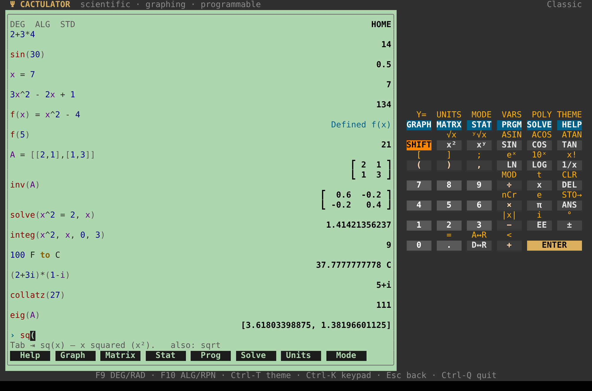

# Getting Started

Never used a graphing calculator? This page gets you comfortable in a few minutes. Start the program with `./cactulator` (or just `cactulator` if you installed it).

## The screen



* The **top line** shows the current modes: angle unit (**DEG**/**RAD**), entry style (**ALG**/**RPN**) and number format.
* The middle is the **history**: what you typed on the left, the answer on the right.
* The **bottom line** is where you type. While you type a function name, a hint below explains it.
* The row of labels at the very bottom are the **soft keys**, triggered by **F1…F8**. They change with each app.
* When the window is big enough, a clickable **keypad** appears beside the display (**Ctrl-K** shows or hides it).

## 1. Calculate

Type `2+3*4` and press **Enter**: the answer `14` appears.

* Press **↑** to bring back an earlier line and edit it.
* Start a line with an operator to continue from the last answer: typing `*2` means `ans*2`.
* Click any result to paste it into the input line.
* **Tab** completes function and variable names.

```text
2^10            → 1024
sqrt(2)         → 1.41421356237
√2              → 1.41421356237
5!              → 120
1/3 + 1/6       → 0.5     (type  frac  to see 1/2)
```

## 2. Store things

```text
x = 7           → 7
3x + 1          → 22          (implicit multiplication)
f(x) = x^2 - 4  → Defined f(x)
f(5)            → 21
5 -> rate       → stores 5 in rate, HP style
vars            → lists everything you've stored
```

Your variables, functions, programs and history are saved automatically when you quit. See [Saved State](Saved-State).

## 3. Draw a graph

Type `plot f(x), x` — or press **F2** to open the GRAPH app and type functions into the Y= list.

* **F3** traces along the curve (or just click on it).
* **F4** opens *Analyze*; choose **Root** to find where the curve crosses zero.
* **Esc** brings you back to HOME.

More in [Graphing](Graphing).

## 4. Try a matrix

Press **F3** on HOME. Type numbers into the grid (Enter moves to the next cell), then press **F2** for the inverse, **F3** for the determinant or **F6** for eigenvalues. Matrices you edit are ordinary variables (`A`, `B`, …) that you can use on HOME: `A*B`, `inv(A)`, `A'`. More in [Matrices](Matrices).

## 5. Ask for help

**F1** opens the built-in guide. Its **Catalog** tab lets you search every function, constant, command and operator — type `matrix`, `angle` or `prob`, then press **Enter** to insert the selected one on HOME. You can also type `help normcdf` on HOME.

## Angles: DEG or RAD?

Cactulator starts in **degrees**, so `sin(30)` is `0.5`. Press **F9** (or type `rad`) for radians. You can always write an angle in degrees explicitly with `°`: `sin(30°)` is `0.5` in both modes.

## Quitting

**Ctrl-Q** quits (pressing **Ctrl-C** twice works too), as does typing `quit`. Everything is saved.

## Where next

* [Expressions and Syntax](Expressions-and-Syntax) — everything you can type
* [Function Reference](Function-Reference) — every built-in function
* [RPN Mode](RPN-Mode) — if you prefer an HP-style stack
* [Programming](Programming) — write your own programs
