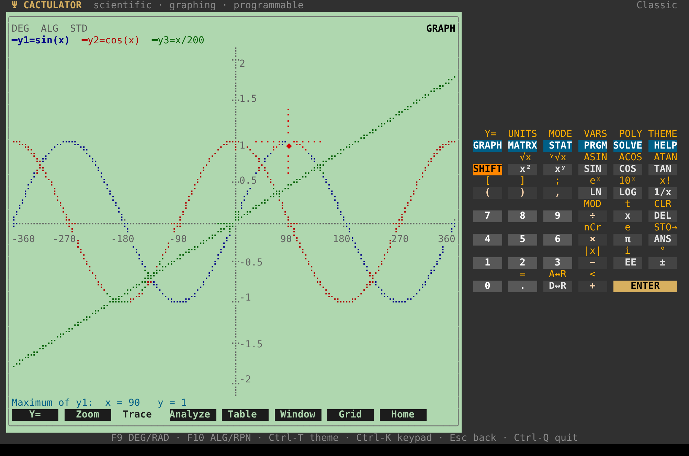

# Graphing

The **GRAPH** app (F2 on HOME) draws up to six curves at once using braille characters, which give each terminal cell 2×4 dots — much finer than one dot per character.



## Quick start

From HOME:

```text
plot sin(x), cos(x)          up to 6 functions of x
plot x^2 - 4                 a leading "y =" is fine too
polar 1 + cos(t)             a polar curve r(θ)
param cos(3t), sin(2t)       a parametric curve x(t), y(t)
```

Or open GRAPH with **F2**. If nothing is set up yet you land in the **Y=** list: type a function of `x`, press **Enter**, add more in the rows below, then press **F1 Graph**.

## The Y= list

| Key | Does |
|---|---|
| **F1 Graph** | draw the enabled curves |
| **F2 Type** | cycle the selected row between *Function*, *Parametric* and *Polar* |
| **F3 On/Off** | enable or disable a curve without deleting it |
| **F4 Clear** | clear the selected row |
| **F5 Window** | edit the viewing window |

Each row gets its own color. Rows are named `y1` … `y6`, and function rows are **real functions on HOME** too: after `y1 = x^2` you can type `y1(3)` → `9`. Conversely, defining `y1(x) = …` on HOME puts it in the list.

Curve types:

* **Function** — an expression in `x`.
* **Parametric** — two expressions in `t`, separated by a comma: `cos(3t), sin(2t)`.
* **Polar** — an expression in `t` (the angle θ): `2sin(4t)`.

The range of `t` comes from the window settings (`t min`, `t max`, `t step`), and `t` is an angle in the current DEG/RAD mode.

## Keys

In the graph view:

| Key | Does |
|---|---|
| **← → ↑ ↓** | pan |
| **+** / **−** | zoom in / out (the mouse wheel zooms around the pointer) |
| **F1 Y=** | back to the function list |
| **F2 Zoom** | In, Out, **Std** (−10…10), **Trig**, **Fit** (fit the y range to the curves), **Square** (equal x/y scale) |
| **F3 Trace** | trace along a curve (or click on one) |
| **F4 Analyze** | the analysis menu, see below |
| **F5 Table** | a table of values |
| **F6 Window** | type exact ranges |
| **F7 Grid** | dotted grid on/off |
| **Esc** | back to HOME |

## Tracing

Press **F3** or click on a curve. Then:

* **← →** move along the curve
* **↑ ↓** switch to another curve
* type a number to jump to that `x`
* **Enter** stores the current point: `x` gets the x-coordinate and `ans` the y-coordinate, ready to use on HOME

The coordinates are shown at the bottom of the screen.

## Analyze (F4)

Each tool starts from the trace cursor:

| Tool | Finds |
|---|---|
| **Root** | where the curve crosses zero, nearest the cursor |
| **Min** / **Max** | the lowest / highest point nearby |
| **Isect** | where the curve meets another curve |
| **dy/dx** | the slope at the cursor |
| **∫dx** | the area under the curve between two x values you type (the area is shaded) |
| **Value** | the y value at any x you type |

Every result is also stored in `ans`.

## Table (F5)

Shows `x` and the value of every enabled function in columns. **↑ ↓** scroll; **F2 Start** and **F3 Step** set the first `x` and the step Δx.

## Window (F6)

Lets you type `x min`, `x max`, `y min`, `y max`, and for parametric and polar curves `t (θ) min`, `t (θ) max` and `t step` (0 means automatic). The soft keys offer **Auto**, **Std**, **Trig**, **Square** and **Grid** presets.

When you graph something new, Cactulator picks a sensible window automatically — trig functions get −360…360 in DEG mode or −2π…2π in RAD mode. Once you change the window by hand, it is kept.

## Tips

* `piecewise(x < 0, -x, x^2)` graphs a function defined in pieces.
* Functions that are undefined somewhere (like `sqrt(x)` for `x < 0` or `1/x` at 0) are simply not drawn there.
* Complex results are not plotted; the curve breaks where the value isn't real.
* For data, use the scatter plot in [STAT](Statistics-and-Probability#scatter-plots) — its **→ y1** key sends the fitted curve here.
* Use `--ascii` if your terminal font has no braille characters (see [Troubleshooting](Troubleshooting-and-FAQ)).
