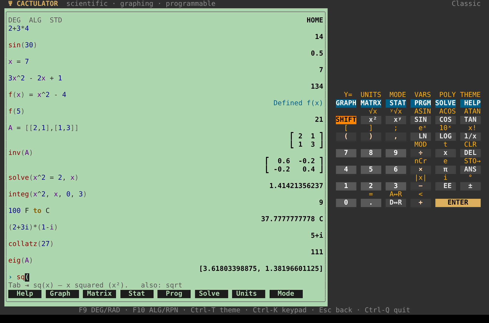

# Cactulator Wiki

**Cactulator** is a programmable graphing calculator for your terminal. It is inspired by the classic HP calculators but designed to be as easy as possible to use: type math the way you write it, or switch to a real RPN stack with one key.



It runs on Linux, macOS, Windows (MSYS2) and Android (Termux), is written in C++17 on top of ncurses, and is free software under the GNU GPL v2 or later.

## Where to start

| If you want to… | Read |
|---|---|
| Build and run it | [Installation](Installation) |
| Learn it in five minutes | [Getting Started](Getting-Started) |
| Know exactly what you can type | [Expressions and Syntax](Expressions-and-Syntax) |
| Look up a function | [Function Reference](Function-Reference) |
| Change angle mode, number format, theme… | [Modes and Settings](Modes-and-Settings) |
| Learn the keys | [Keyboard and Mouse](Keyboard-and-Mouse) |

## The apps

Cactulator opens on **HOME**, the calculation screen. Each app is one function key away and **Esc** always brings you back.

| Key | App | Page |
|---|---|---|
| F1 | HELP — guides and a searchable catalog | [Function Reference](Function-Reference) |
| F2 | GRAPH — functions, parametric and polar curves, trace, analysis, table | [Graphing](Graphing) |
| F3 | MATRIX — spreadsheet-like matrix editor and linear algebra | [Matrices](Matrices) |
| F4 | STAT — data lists, statistics, regressions, scatter plots | [Statistics and Probability](Statistics-and-Probability) |
| F5 | PRGM — program editor and runner | [Programming](Programming) |
| F6 | SOLVE — equation solver and polynomial roots | [Solving and Calculus](Solving-and-Calculus) |
| F7 | UNITS — unit converter | [Unit Conversion](Unit-Conversion) |
| F8 | MODE — settings | [Modes and Settings](Modes-and-Settings) |
| F10 | RPN entry (toggle) | [RPN Mode](RPN-Mode) |

## Reference

* [HOME Commands](HOME-Commands) — `deg`, `fix 4`, `frac`, `plot`, `vars`, `del`…
* [Command Line and REPL](Command-Line-and-REPL) — `-e`, piping, `--state`, scripting
* [Saved State](Saved-State) — where your variables, programs and history live
* [Troubleshooting and FAQ](Troubleshooting-and-FAQ)

## For developers

* [Architecture](Architecture) — how the source is organized and how an input line becomes a result
* [Contributing](Contributing) — building, testing, adding functions, units and constants

## A taste

```text
2+3*4                          → 14
sin(30)                        → 0.5          (DEG mode)
(2+3i)*(1-i)                   → 5+i
f(x) = x^2 - 4                 → Defined f(x)
solve(f(x) = 0, x, 1)          → 2
integ(exp(-x^2), x, -inf, inf) → 1.77245385091
inv([[1,2],[3,4]])             → [[-2, 1], [1.5, -0.5]]
5 km to mi                     → 3.10685596119 mi
polyroots([1, -6, 11, -6])     → [1, 2, 3]
```

> Cactulator comes with **ABSOLUTELY NO WARRANTY**. Results come from numerical methods and can be wrong; double-check anything important.
