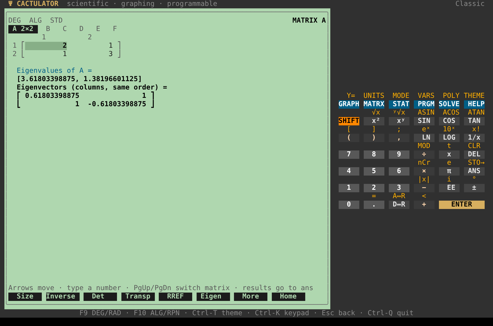

# Matrices

Matrices can be typed directly on HOME or edited in the spreadsheet-like **MATRIX** app (F3 on HOME).



## On HOME

```text
A = [[1, 2], [3, 4]]       rows inside brackets
B = [1, 2; 3, 4]           or rows separated by ;
v = [5, 11]                a list is a vector

A * B                      matrix product
A * v                      matrix × vector
inv(A)   A^-1   A⁻¹        inverse
A'                         transpose
det(A)                     → -2
A^3                        integer powers
solve(A, v)                solve A·x = v  → [1, 2]
A \ v                      the same
A[2, 1]                    → 3   (row 2, column 1; counting starts at 1)
A[2, 1] = 7                change one entry
```

Useful functions (all in the [Function Reference](Function-Reference#matrices)):

| Function | Gives |
|---|---|
| `det(A)`, `trace(A)`, `rank(A)` | determinant, trace, rank |
| `inv(A)`, `transpose(A)` | inverse, transpose |
| `rref(A)` | reduced row echelon form |
| `eig(A)` | eigenvalues, largest first (complex when needed) |
| `eigvec(A)` | eigenvectors as columns, in the same order as `eig(A)`, scaled so the largest entry is 1 |
| `identity(n)`, `zeros(r, c)`, `ones(r, c)`, `diag(list)` | building blocks |
| `size(A)`, `rows(A)`, `cols(A)` | dimensions |
| `row(A, i)`, `col(A, j)`, `diag(A)` | pieces |
| `augment(A, B)` | `[A B]` side by side |
| `norm(v)`, `dot(u, v)`, `cross(u, v)` | vector operations |

Element-wise operations: `A + B`, `A - B`, `2*A`, and scalar functions like `sqrt(A)`. Matrices can contain complex numbers.

## The MATRIX app

The tabs along the top are the matrices **A … F**. They are ordinary variables, so whatever you edit here is available on HOME, and vice versa. Click a tab (or use **Name** under *More*) to switch.

Type a number (or any expression) into a cell and press **Enter**; arrow keys move between cells. Results of operations appear below the grid.

### Keys

| Key | Does |
|---|---|
| **F1 Size** | set the dimensions, e.g. `3 3` or `2x4` |
| **F2 Inverse** | inverse of the current matrix |
| **F3 Det** | determinant |
| **F4 Transp** | transpose |
| **F5 RREF** | reduced row echelon form |
| **F6 Eigen** | eigenvalues and eigenvectors |
| **F7 More** | the second page of keys: |
| ↳ **F1 Rank**, **F2 Trace** | rank, trace |
| ↳ **F3 Ax=b** | solve `A·x = b`; `b` can be a matrix name (`B`) or a list (`[1, 2, 3]`) |
| ↳ **F4 Power** | raise the matrix to a power |
| ↳ **F5 Store** | store the last result in a variable (e.g. `B`) |
| ↳ **F6 Name** | edit another matrix by name |
| ↳ **F7 Ident** | make the current matrix an identity matrix |
| **F8 Home** | back to HOME |

From HOME, `matrix B` opens the app directly on `B`.

## Numerical notes

* Inverses and linear systems use Gaussian elimination with partial pivoting. A singular matrix gives a clear error: *this matrix is singular (its determinant is 0), so it has no inverse*.
* Eigenvalues are computed by Householder reduction to Hessenberg form followed by the shifted QR algorithm, so non-symmetric matrices and complex eigenvalues work: `eig([[0,1],[-1,0]])` → `[i, -i]`.
* Results are floating-point. When displaying, parts that are negligible compared with the rest of the value (below about 10⁻¹³ of it) are shown as 0, so `A*inv(A)` prints as a clean identity matrix.
