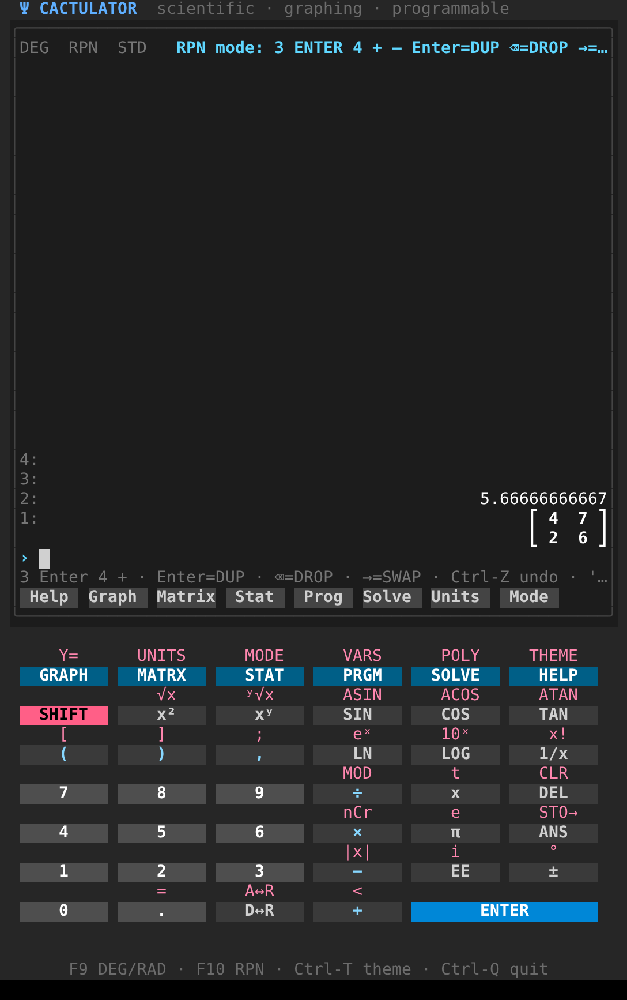

# Modes and Settings

Open the **MODE** app with **F8** on HOME (or type `mode`). Use **↑ ↓** to pick a setting and **← →**, **Enter** or **Space** to change it; clicking a row works too. A live preview at the bottom shows how `1/3`, `255` and `12345.678` will look.

Every setting also has a keyboard shortcut or a [HOME command](HOME-Commands), and all of them are saved with your [state](Saved-State).

| Setting | Values | Shortcut / command |
|---|---|---|
| Angle unit | Degrees (DEG), Radians (RAD) | **F9**, `deg`, `rad` |
| Entry style | Algebraic, RPN (stack) | **F10**, `alg`, `rpn` |
| Number format | Standard, Fixed decimals, Scientific, Engineering | `std`, `fix n`, `sci n`, `eng n` |
| Decimals | 0–15 (used by Fixed, Scientific, Engineering) | the `n` in `fix n` |
| Fractions | On, Off | `frac` |
| Whole numbers in | Decimal, Hexadecimal, Binary, Octal | `dec`, `hex`, `bin`, `oct` |
| Theme | Classic, Cactus, Retro LCD, Midnight, Paper | **Ctrl-T**, `theme name`, `--theme` |
| Keypad | Automatic, Always, Hidden | **Ctrl-K**, `keypad` |
| Splash screen | On, Off | `--no-splash` for one run |

## Angle unit

Affects `sin`, `cos`, `tan` and their inverses, `sec`/`csc`/`cot`, `atan2`, `arg`, `polar`, `rect`, polar graphs and the default graph window. In DEG mode trig graphs start with an x range of −360…360; in RAD mode −2π…2π.

Calculus also follows the angle mode, because the variable *is* an angle: in DEG mode `deriv(sin(x), x, 0)` is `π/180 ≈ 0.01745`, not `1`. Switch to RAD for textbook calculus.

## Number format

| Format | `1/3` | `12345.678` |
|---|---|---|
| Standard | `0.333333333333` | `12345.678` |
| `fix 3` | `0.333` | `12345.678` |
| `sci 2` | `3.33E-1` | `1.23E4` |
| `eng 2` | `333.33E-3` | `12.35E3` |

The format only affects display: values are always kept at full double precision.

## Fractions

With fractions on, results that are close to a simple fraction — or a simple fraction of π — are shown exactly:

```text
0.75           → 3/4
1/3 + 1/6      → 1/2
0.1 + 0.2      → 3/10
2/3*pi         → 2π/3
```

You can also convert a single value with `tofrac(0.375)` → `3/8`.

## Number bases

With `hex`, `bin` or `oct`, whole-number results are shown in that base (`255` → `0xFF`). Non-integers still show in decimal. You can type numbers in any base at any time (`0xFF + 0b101`), and convert single values with `hex(n)`, `bin(n)`, `oct(n)`. Bitwise functions: `band`, `bor`, `bxor`, `shl`, `shr`.

## Themes

Five color themes are built in:

* **Classic** — dark gray body with amber and orange accents
* **Cactus** — green body
* **Retro LCD** — green-on-black, like an old LCD
* **Midnight** — near-black with blue accents
* **Paper** — light background, good for bright rooms and screenshots



Themes use the 256-color palette when your terminal supports it and fall back to the 16 or 8 basic colors otherwise.

## Keypad

The clickable keypad appears beside the display when the window is big enough (**Automatic**), always (**Always**), or never (**Hidden**). Blue keys open apps; the orange label above a key is its **SHIFT** function — click SHIFT, then the key.

## Splash screen

The cactus welcome screen at start-up. Turn it off permanently in MODE, or for one run with `cactulator --no-splash`.
