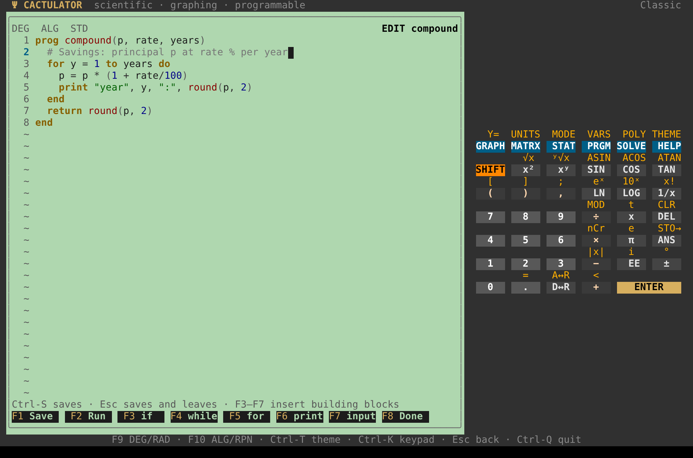

# Programming

Cactulator has two kinds of user code: **one-line functions** for formulas and **programs** for anything with steps, loops or decisions. Both are called like built-in functions and both are saved automatically.



## One-line functions

Type them on HOME:

```text
f(x) = x^2 + 1
area(w, h) = w*h
bmi(kg, m) = kg / m^2
```

Then use them anywhere — on HOME, in other functions, in graphs, in `solve`, `integ` and friends:

```text
f(3)                    → 10
integ(f(x), x, 0, 1)    → 1.33333333333
plot f(x), f(x - 2)
```

One-line functions can read global variables (`g(x) = x + a` uses the current value of `a` each time it is called).

## Programs

```text
prog collatz(n)
  # How many steps until the Collatz sequence reaches 1?
  steps = 0
  while n != 1 do
    if n % 2 == 0 then
      n = n / 2
    else
      n = 3*n + 1
    end
    steps = steps + 1
  end
  return steps
end
```

Run it from HOME: `collatz(27)` → `111`. (`function` is accepted as a synonym of `prog`.)

### The language

| Statement | Example |
|---|---|
| assignment | `x = 5`, `5 -> x`, `v[3] = 7`, `A[2, 1] = 0` |
| if | `if cond then … elif cond then … else … end` (`elseif` and `else if` also work) |
| while | `while cond do … end` |
| counting loop | `for k = 1 to 10 do … end`, `for k = 10 to 1 step -1 do … end` |
| loop over a list | `for v in [3, 5, 8] do … end` |
| repeat | `repeat … until cond` |
| leave / skip | `break`, `continue` |
| finish | `return value` (or just `return`) |
| output | `print "x is", x` — items are separated by spaces |
| input | `n = input("How many?")` — asks the user while the program runs |
| globals | `global x, y` — assign to HOME variables instead of locals |
| comment | `# anything after a hash` |

The `then` and `do` keywords are optional. Statements are separated by new lines or `;`, so short blocks fit on one line: `if g < secret then print "too low" end`.

Conditions use comparisons (`==`, `!=`, `<`, `>`, `<=`, `>=`; a single `=` also works in a condition) combined with `and`, `or` and `not`. Any non-zero number counts as true.

### Variables and scope

* Parameters and every variable you assign inside a program are **local**. A program can't accidentally overwrite your HOME variables.
* A program can **read** global variables that it doesn't assign.
* To change a HOME variable, declare it first: `global total`.
* Programs can call other programs and functions, including themselves (recursion). Calls nest up to 250 deep; deeper recursion stops with *too many nested calls (is a function calling itself forever?)*.

```text
prog fact2(n)
  if n <= 1 then return 1 end
  return n * fact2(n - 1)
end
```

### Lists and matrices in programs

```text
out = []                  an empty list
out[k] = a                assigning past the end grows the list (gaps are filled with 0)
len(out)                  its length
A = zeros(3, 3)
A[2, 3] = 7
```

All the list, statistics and matrix functions are available. Indexes start at 1.

### Text

Strings are written in double quotes. Join them with `+` and convert numbers with `str`: `print "total: " + str(t)`. `print` with several comma-separated items prints them separated by spaces.

### Return value

A program returns whatever `return` gives it. A program without `return` shows **Done** on HOME.

## The PRGM app

Open with **F5** on HOME (or `prog`). It lists your programs and functions.

| Key | Does |
|---|---|
| **F1 New** | start a new program in the editor |
| **F2 Edit** | edit the selected program |
| **F3 Run** | run it; if it has parameters, you are asked for their values (separate several with commas) |
| **F4 Delete** | delete it |
| **F5 Function** | create a one-line function, e.g. `area(r) = pi*r^2` |

`edit name` on HOME opens a program directly in the editor.

### The editor

A small code editor with syntax highlighting and automatic indentation (lines after `then`, `do`, `else`, `repeat` and `prog` are indented).

| Key | Does |
|---|---|
| **F1 Save** / **Ctrl-S** | check and save |
| **F2 Run** | save and run |
| **F3 if**, **F4 while**, **F5 for**, **F6 print**, **F7 input** | insert a template |
| **F8 Done** | save and close |
| **Esc** | save and close; if the program has an error, press **Esc** again to discard your changes |
| **Tab** | insert two spaces |
| **Ctrl-D** | duplicate the current line |
| **Ctrl-X** | delete the current line |
| **Home/End**, **Ctrl-A/E**, **PgUp/PgDn** | move around |

Saving checks the syntax and points to the line of any error.

### Running and stopping

`print` output appears on HOME. `input` pops up a prompt. Press **Esc** to stop a program that runs too long. Errors inside a program report the line they happened on.

## Bundled examples

On the first run (and whenever no saved state is found) these examples are installed. Open them in PRGM to see how they work:

| Program | Try | Shows |
|---|---|---|
| `collatz(n)` | `collatz(27)` → `111` | `while`, `if/else` |
| `quadratic(a, b, c)` | `quadratic(1, -3, 2)` → `[2, 1]` | `print`, returning a list |
| `fib(n)` | `fib(10)` → `[0, 1, 1, 2, …, 34]` | `for`, growing a list |
| `primes(n)` | `primes(30)` ¹ | `isprime`, building a list |
| `guess()` | `guess()` | `input`, `repeat … until`, a game |
| `compound(p, rate, years)` | `compound(1000, 5, 10)` | a table printed year by year |

A sample one-line function `f(x) = x^2 - 2x - 3` is installed as well.

¹ In the current version the bundled `primes` program stops with *'count' is a built-in function; pick another name (line 4)*, because `count` is an alias of `len`. Open it with `edit primes` and rename the variable `count` (e.g. to `found`) in all three places to fix your copy. See [Troubleshooting and FAQ](Troubleshooting-and-FAQ#known-issues).

Variable names can't reuse built-in function names or their aliases (`sum`, `count`, `len`, `mean`, …). If you get *'…' is a built-in function; pick another name*, choose a different name.

## Typing programs outside the editor

In the plain REPL (or when piping input), a line starting with `prog`, `if`, `while`, `for` or `repeat` continues until its matching `end`/`until`, so you can paste whole programs:

```bash
printf 'prog sq2(n)\n  return n^2\nend\nsq2(12)\n' | cactulator
```

See [Command Line and REPL](Command-Line-and-REPL).
