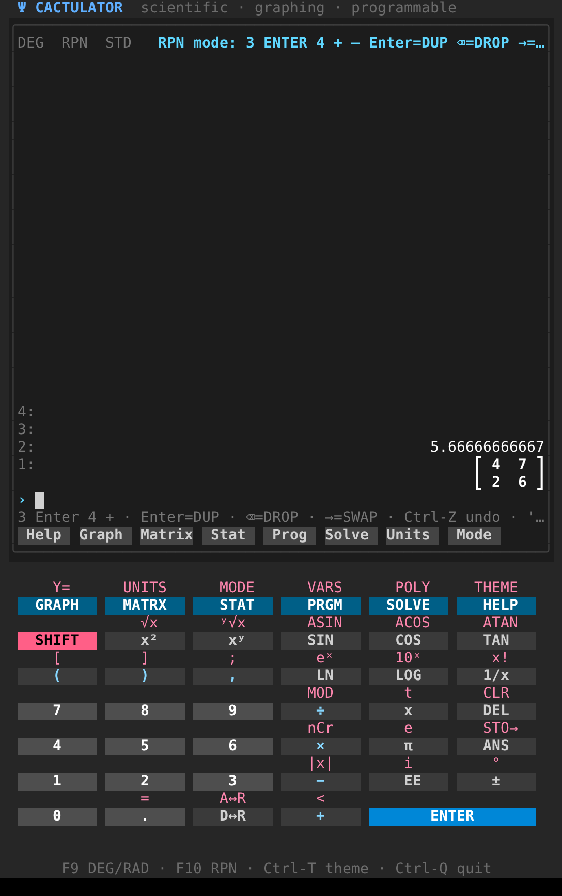

# RPN Mode

RPN (Reverse Polish Notation) is the classic HP way of calculating: numbers go on a **stack** and operators take their arguments from it. No parentheses, no `=` key.

Press **F10** (or type `rpn`) to switch to RPN; press **F10** again (or type `alg`) to go back. The HOME title changes to **RPN STACK** and the stack is shown with level 1 at the bottom.



## The basics

```text
3 Enter 4 +          → 7
2 Enter 3 + 4 *      → 20          ( (2+3)*4 )
2 sqrt               → 1.41421356237
30 sin               → 0.5          (DEG mode)
```

When you press `+ - * / ^` right after typing a number, the number is pushed and the operator is applied immediately — no need to press Enter first. You can also type a whole line of space-separated words and press Enter: `3 4 + 2 *` → `14`.

## Keys

| Key (with an empty input line) | Does |
|---|---|
| **Enter** | duplicate level 1 (DUP) |
| **⌫ Backspace** / **Delete** | drop level 1 (DROP) |
| **→** | swap levels 1 and 2 (SWAP) |
| **Ctrl-Z** | undo the last operation |

When the input line is not empty, these keys edit the line as usual.

## Stack words

| Word | Does |
|---|---|
| `dup`, `dup2` | duplicate level 1 / levels 1–2 |
| `drop`, `drop2` | remove level 1 / levels 1–2 |
| `swap` | exchange levels 1 and 2 |
| `over` | copy level 2 to the top |
| `rot` | move level 3 to the top |
| `clr` | clear the whole stack |
| `depth` | push the number of items on the stack |
| `neg`, `chs`, `+/-`, `±` | change the sign of level 1 |

> Typing `clear` alone clears the **screen history** (it is the HOME `cls` command), not the stack. Use `clr` to empty the stack.

## Functions

Any built-in or user function works as a word. It takes as many arguments as it needs from the stack:

```text
2 3 hypot            → 3.60555127546
10 3 nCr             → 120
[1, 2, 3] sum        → 6
5 !                  → 120
f                    → calls your own f(x) on level 1
```

Functions that take a variable number of arguments (`min`, `max`, `gcd`, …) use level 1 if it is a list, otherwise levels 1 and 2.

Functions that work on *expressions* — `solve`, `integ`, `deriv`, `seq` and friends — must be typed in quotes (see below).

## Storing and recalling

```text
5 sto x              store level 1 in x and drop it
5 →x                 the same (also ->x)
x                    push the value of x
```

## Algebra inside RPN

Put an algebraic expression in single quotes to evaluate it and push the result:

```text
'x^2 + 1'
'integ(x^2, x, 0, 3)'
```

Lists and matrices can be typed directly: `[1, 2, 3]`, `[[1,2],[3,4]] inv`. Strings use double quotes.

## Errors are atomic

If anything in a line fails, the whole line is undone and the stack is restored to how it was before. Ctrl-Z undoes successful operations one at a time.

## Saved

The stack is saved with your [state](Saved-State) and is still there next time you start Cactulator. The `ans` variable always holds level 1, so you can switch to algebraic mode and keep going.
